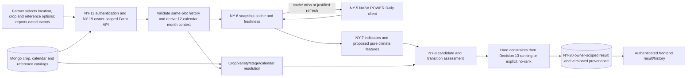

# NY-38 Farm History, Crop Catalog, and NASA Decision Research Handoff

## Executive conclusion

NovaYield already has a working FastAPI route, a NASA POWER Daily client, a MongoDB snapshot cache, three environmental indicators, an evidence-gated rotation scorer and owner-scoped result history. The next workflow still needs **one canonical database crop catalog; actual dated crop events stored with the farm; automatic minimum-12-calendar-month context; crop-specific future timing; and a reviewed calculation that lets NASA measurements affect a crop assessment**. The current code cannot honestly claim that rainfall or temperature alters the crop ranking. These are confirmed architectural gaps, not reasons to create a second NASA or scoring stack.

This research ticket authorizes **documentation only**. The proposed [data dictionary and API contract](ny-38-data-contract.md) and [crop/NASA evidence and method specification](ny-38-crop-climate-evidence.md) are the implementation handoff. They include a testable NASA dry-spell feature and the data gates for a fuller crop-water method. The proposed rule for changing option order would amend Product Owner Decision 13's tie/scoring behavior, so **it is not authorized for code until the Product Owner reviews this handoff**. No named pilot crop currently has a complete pilot-specific stage/calendar package needed to activate the proposed climate rule. All local crop, variety, calendar and agronomic application remains provisional under Decision 9. No schema, seed, route, engine or Jira issue was changed by this research.

### Evidence and authority

1. **Product requirements:** *NovaYield MVP PRD*, version 1.0, 15 October 2026, especially §§2–11 and Appendix A; read from the original document. The PRD calls for NASA data to influence reasoning, at least two indicators, a small sourced crop library, three-event comparisons, visible uncertainty, and no unsupported field measurement or yield claim.
2. **Approved project decisions:** [canonical decision record](../../novayield-research-and-product-decisions.md#6-finalized-product-decisions-and-provisional-assumptions), especially Decisions 2–4 and 8–9, Decision 13's comparable-evidence fallback, and Decision 14's direction to connect climate to crop needs through reviewed rules.
3. **New Product Owner clarifications in NY-38:** history crops come from the same catalog as recommendation candidates; retain each event's crop/order/actual date range; derive at least 12 calendar months of farm context without changing event dates; make NASA values affect decision logic; defer the visible current-practice baseline. These are approved directions, not statements that crop facts have been locally validated.
4. **Challenge guide:** the indexed [official 2026 Field Shift challenge page](https://www.spaceappschallenge.org/2026/challenges/field-shift-adapting-farms-with-nasa-data/) confirms its core NASA + local soil/crop + farmer-priority decision-support objective. The full page could not be independently read on 5 November. The detailed optional-data and baseline items below are therefore classified from the **NY-38 ticket's description of the guide**, not falsely presented as freshly verified official page text. Recheck the page if it becomes available.
5. **Existing handoffs:** [NY-13 POWER inputs](ny-13-nasa-power-input-specification.md), [NY-8 crop evidence](ny-8-crop-criterion-evidence-matrix.md), [NY-8 provisional rules](ny-8-provisional-rotation-rules.md), [NY-8 public area archetype](ny-8-public-demo-profile.md), and [NY-9 calendar evidence](ny-9-pilot-season-calendar-evidence.md). Their older statements that all missing criteria prevent ranking or NASA can remain context-only are superseded by Decisions 13 and 14 respectively.

## 1. Challenge, PRD and product crosswalk

The official challenge's core objective is a decision-support tool combining NASA Earth observations with local soil, crop characteristics and farmer priorities. The extra guide items listed in NY-38 are suggestions to assess, not an instruction to add every dataset. “Required” below means required by the PRD or the Product Owner's approved NY-38 clarification.

| Challenge/guide topic | PRD and approved direction | Current evidence | Classification and action |
| --- | --- | --- | --- |
| NASA observations plus local soil, crop and farmer priorities | PRD §§2, 4, 7; Decisions 2, 13–14 | [Farm](../../backend/app/models/farms.py) stores free-text soil/irrigation/history and points; [NY-8](../../backend/app/decisions/crop_evidence.py) uses provisional crop classes; NASA values are attached only | **Material gap:** canonical catalog, dated history and reviewed numerical climate effect. |
| Historical precipitation/temperature and explainable indicators | PRD FR-02/03, §8; Decision 4 | [NY-5 client](../../backend/app/integrations/nasa/power.py), [NY-6 cache](../../backend/app/services/environmental_snapshots.py) and [NY-7 indicators](../../backend/app/indicators/environmental.py) exist | **Already supported for retrieval/summary;** verify current response metadata and add the derived context and climate reference. |
| Three consecutive crop events and comparison | PRD FR-05–08; Decision 13 | [NY-8 generator/scorer](../../backend/app/decisions/rotation.py) handles three slots/top three, but dates are caller-supplied and crop profiles are in memory | **Required:** use crop-specific, sourced future timing and shared catalog; return fewer/unranked when evidence does not support three. |
| Existing rotation/current-practice baseline | PRD baseline where known, FR-05/08; NY-38 explicitly defers the visible baseline | [NY-9](../../backend/app/api/workflows.py) currently constructs a three-event baseline from past crops | **Approved MVP scope change:** remove inferred user-facing baseline in later implementation. Historical events inform transitions; they are not a complete future current-practice sequence. Do not claim the PRD baseline is satisfied by them. |
| Soil health, nutrient cycling, erosion and pest-cycle disruption | PRD §7 supports sourced soil-health potential; FR-09 warns against field-measurement claims | Soil/yield/labour often `not_assessed`; repeat-crop warning exists | **Required explanation where supported;** quantified soil improvement, N credit, pest break or erosion diagnosis is **optional/deferred** without local field and management evidence. |
| Water stress, heat, evaporation, vegetation and uncertainty | PRD water/yield proxy, ≥2 POWER indicators, limitations; Decision 14 | Rainfall/T summaries are available; no ET0, crop-stage or field water method | **Material gap** for crop-specific climate link. Additional NASA variables and a full water balance need separate evidence/input review. |
| SMAP, ECOSTRESS, GPM, Landsat, MODIS, GRACE/GRACE-FO, SRTM | PRD §8 makes SMAP P1 investigation; §17 defers additional observations | No such integration is needed to run NY-5/6/7 | **Optional/deferred**, not a NASA mandate. Evaluate SMAP/GPM later only if they materially improve a validated pilot use case. |
| Interactive maps, overlays and scenario sliders | PRD mobile-responsive explanation, no map requirement | Supported location labels intentionally hide coordinates | **Optional/deferred.** A public place point is not a plot polygon or field vulnerability map. |
| Farmer constraints and human judgment | PRD §§2, 5, 7, 10; Decisions 9/13 | Priorities affect current scoring; incomplete evidence/limitations are displayed | **Partly supported;** catalog-based input and truthful missing-state flow remain required. Advice is provisional, not an automated prescription. |

The PRD's illustrative crop list included sorghum and soybean, but Decision 2 approved maize, cowpea, groundnut, cassava, yam and rice. The NY-38 six-candidate scope follows that decision. The visible baseline deferral is a newer Product Owner choice; keep its difference from the original PRD explicit in public claims and implementation notes.

## 2. Baseline and confirmed implementation gaps

At the start of this audit the working tree was clean. The branch `NY-38-research-and-verify-the-farm-history-crop-library` and `origin/dev` both point to `78e0589`, PR #28. `dev` is the current research/implementation baseline. `master` is 21 commits behind and five merge-history commits ahead of `dev`; its tree lacks the newer NY-9/10/19/20 modules. Do not start NY-39/40 from `master` or blindly merge it into this branch. Review any later changes to `dev` before implementing this handoff. No Git history was rewritten.

| Area and current source | Implemented | NY-38 gap / consequence |
| --- | --- | --- |
| [Farm document](../../backend/app/models/farms.py), [DTO](../../backend/app/schemas/farms.py), [owner routes](../../backend/app/farms/routes.py) (NY-19) | Mongo `Farm` has owner, supported `location_key`, name, free-text soil/irrigation/previous crops/current practice and priorities; owner-scoped CRUD and label-only location responses | No typed crop ID, event dates/order, plot history state, soil/irrigation catalogs or schema revision. Free text cannot authorize an agronomic trait or create a dated event. |
| [Crop profiles](../../backend/app/decisions/crop_profiles.py), [evidence](../../backend/app/decisions/crop_evidence.py) (NY-8) | Six in-memory crop profiles; sourced provisional water classes; rice unassessed without ecology | No Mongo canonical crop/variety/calendar records. Static weakest-crop water class does not change with actual NASA values, soil or irrigation. |
| [NY-9 request](../../backend/app/schemas/decision_workflows.py), [orchestration](../../backend/app/api/workflows.py) | Requires exactly three caller-supplied historical analysis periods and three future slots, retrieves NASA per period, sends indicators to NY-8 and saves NY-20 result | Past *analysis* windows are not actual planted/harvest dates; no 1–3 saved events, derived 12-month period or automatic future dates. Only the last past crop is passed as prior history, and three past crops are treated as the baseline, contrary to the clarified scope. |
| [NY-5 client](../../backend/app/integrations/nasa/power.py), [NY-6 snapshot](../../backend/app/models/environmental_snapshots.py), [service](../../backend/app/services/environmental_snapshots.py) | Fixed three-parameter Daily AG/UTC request, normalized series, HMAC identity, Mongo reuse/refresh with valid-cache fallback | Do not duplicate these. A live 1991–2020 Ejura request with the same three-parameter bundle succeeded; its distinct date range already gives a separate cache identity. Rain-only parameter selection would require NY-5 and NY-6 changes, not a URL tweak. Review GEOS-IT→MERRA-2 refresh. Runtime currently has no configured source-specific refresh intervals, so freshness is often `unknown`. |
| [NY-7 indicator service](../../backend/app/indicators/environmental.py) | Sum precipitation and mean `T2M`/`T2M_MAX` with coverage metadata | No CDD, long-term normal, stage alignment, anomaly, ET0 or crop-water calculation. |
| [NY-20 result](../../backend/app/models/rotation_results.py), [repository](../../backend/app/repositories/rotation_results.py) | Owner+farm references and append-only generated/scored payloads with versions; owner-scoped history/detail | New results need explicit farm history, derived-context/reference IDs, crop/calendar/method revisions, numerical feature status and baseline deferral. Old v1 results must remain readable as originally generated. |
| [Frontend field setup](../../frontend/src/pages/FieldSetup.tsx) | Mock form, mock submission | Hardcoded crop options include sorghum/soybean and omit some approved candidates; one crop with no dates/order, free-text location. NY-39/40 must coordinate the catalog API and new farm flow with its owner; NY-38 does not edit it. |

## 3. Farm history and the minimum-12-month rule

**Proposed event meaning:** one `CropHistoryEvent` is one crop's planting/establishment start through its harvest/removal/end of crop presence on the same decision plot, inclusive, as reported by the farmer in local calendar dates. `sequence_order=1` is oldest and must agree with dates. An event retains the resolved canonical crop ID and stable key snapshot. One to three complete, dated events may be stored. A repeated crop in later non-overlapping events remains a truthful record and can trigger a review warning; it is not a duplicate to delete. A duplicate event ID/order or reversed/future date is invalid. This contract does **not** convert historic NASA analysis windows into farmer event dates.

The proposed one-Farm-one-decision-plot boundary is a Product Owner review item. If a farm has several plots, their histories and soil states cannot be mixed under one Farm record. The [data dictionary](ny-38-data-contract.md) proposes embedded events because at most three belong to one plot and an owner-scoped Farm update can validate the whole ordered sequence atomically. Mongo references are application-checked, not relational foreign keys.

**Gap/overlap policy:** consecutive events have `next.start_date > previous.end_date`. A seasonal interval between crops is not invalid by itself. An unreported interval is **unknown**, never automatically fallow; a farmer-declared idle/fallow period may be separately retained with its own dates/source if the Product Owner approves that UI. Overlapping events may indicate intercropping, which is documented in [Ghana forest–savanna farming research](https://biblio.iita.org/documents/S17InbkKuyperIntercroppingNothomNodev.pdf-a2205c618fc1ecce13d043c879e43b6a.pdf) and in an [Ejura maize–groundnut experiment](https://www.scirp.net/journal/paperinformation?paperid=123866). The present sole-crop sequence model cannot flatten an overlap into false order: mark `needs_review`/unsupported, retain the truthful report if an incomplete-profile route is approved, and withhold a sequential recommendation. A gap can hide an unreported crop, so a rank needs confirmation of same-plot continuity rather than assuming it. A confirmed fallow interval is a truthful history state, not measured soil recovery.

**Unknown/legacy policy:** existing `previous_crops` text has no dates, order assurance or catalog identity and cannot be migrated into events by inference. Old Farms remain readable with `legacy_unresolved`; their owner must provide dated catalog selections before this new recommendation path can use them. An unknown crop/date may be saved only as an explicit incomplete state if Product Owner review accepts that path. Do not silently turn `current_practice` into a three-event future baseline; its visible input is deferred.

| Proposed farm input | MVP classification and use | Why / unresolved gate |
| --- | --- | --- |
| Supported location, 1–3 selected crop IDs, order and actual start/end dates | **Required** for a complete decision-plot history | NY-38 Product Owner direction; unresolved dates can only enter a separately approved incomplete-profile path. |
| Crop variety | **Optional to record**, `needs_review` for any variety-specific duration, stage or water trait when unknown | A named CSIR/MoFA variety result cannot be generalized to all varieties. |
| Rice ecology/production system | **Required before rice-specific assessment**; may be unknown in an incomplete history | Upland, rain-fed lowland and irrigated rice have different water and management contexts. |
| Soil-texture and irrigation-access catalog choice | **Required selection or explicit `unknown`** in the proposed completed form | Both are farmer-reported categories; neither is measured field capacity or delivered water. Label choices await Product Owner approval. |
| Residue handling and soil-fertility observations | **Optional to report; `needs_review` for a rule that depends on them** | No nitrogen credit or measured soil outcome follows from a crop name or self-reported texture. |
| Labour availability, plot area and machinery | **Optional to report; labour feasibility remains `not_assessed` without comparable farm and crop-operation evidence** | Decision 13 still displays labour; optional inputs do not create a rating by themselves. |
| Market constraints | **Deferred from the current scoring contract** | The PRD's four criteria do not establish a local profitability/market model. A future product decision could add it. |
| Farmer priority points | **Optional at profile creation**; equal weights apply when no applicable positive points are saved | Decision 13 defines the default and normalization behavior. |
| Current plot occupancy/next availability | **Needs Product Owner decision before automatic future timing** | The last historical harvest does not prove the plot is vacant today. |

### Exact context derivation

For at least one complete valid event, use calendar-month arithmetic on date-only values:

```text
history_start = earliest reported event.start_date
history_end   = latest reported event.end_date
context_end   = history_end
context_start = earlier_of(history_start, subtract_12_calendar_months(context_end))
```

`subtract_12_calendar_months` keeps the month/day when valid and clamps an invalid anniversary to the last day of that month (e.g. 29 February 2024 → 28 February 2023). Bounds are inclusive, so this is **at least** a calendar year of dated context, not a fixed `365`-day subtraction. The farmer never provides an extra environmental range; the backend derives it from saved events without changing any event date. Preserve a past context end even when it is old, and label its age. If NASA has not published the last reported days, keep the requested end and show partial/unavailable coverage; never shift the event end or fabricate daily values.

| Synthetic history example | Derived values | Why it matters |
| --- | --- | --- |
| One event `2026-03-15..2026-07-15` | `history_start=2026-03-15`, `history_end=2026-07-15`, `context=2025-07-15..2026-07-15` | The history is shorter than 12 months; the NASA window extends backward only. |
| Three ordered events spanning `2024-01-10..2026-09-30` | `history_start=2024-01-10`, `history_end=2026-09-30`, `history_end−12 months=2025-09-30`, `context=2024-01-10..2026-09-30` | A history longer than 12 months is retained whole. |
| One event ending on leap day `2024-02-29` | `history_end−12 months=2023-02-28`; context starts at the earlier of that date and the event start | Uses calendar months and a documented leap-day clamp. |

These examples test **date arithmetic**, not crop growth duration or a real farm. Missing events or an invalid chronology produce no derived context. NASA Daily starts in 1981; if a derived context begins before supported coverage, return an explicit unavailable/partial state and preserve the farmer's reported dates.

## 4. Crop library, reference data and future event timing

The [data contract](ny-38-data-contract.md) proposes one Mongo `crops` identity catalog with immutable keys, scoped immutable `crop_profile_revisions`, versioned `crop_calendars`, and backend-managed `farm_reference_options` for soil texture and irrigation access. Both the history picker and recommendation service resolve the same crop identity. Each populated trait carries source, publication date if known, geography, variety, system, management, units, confidence, pilot transferability, limitations and review status. An absent or suspect value stays unknown; a [CSIR catalog](https://technologies.csirgh.com/maincropvarieties) zero duration or reversed range is not a valid maturity period.

The six recommendation candidates come from Decision 2; their inclusion does not establish that every crop is suitable at every pilot place. The [Municipal Assembly](https://esma.gov.gh/about-us/town-profile/) and [MoFA district profile](https://mofa.gov.gh/site/directorates/55-district-directorates/district-ashanti/164-ejura-sekyeredumase) also mention plantain, guinea corn and ambiguous “beans.” A six-record-only selector would block truthful history for some farmers. A `history_only` identity in the same catalog is a concrete option for Product Owner review; it would not add a seventh recommendation candidate. Until approved, unsupported crops cannot be silently mapped or entered as free text for decision use.

### Deterministic future scheduling proposal

The next three **future planting events** must be derived server-side, not submitted as windows in a recommendation request. A candidate's location/community, named crop variety or applicable profile, production system, planting-window source/version and maturity definition determine its timing. Rice requires ecology; generic yam cannot inherit a *D. rotundata* duration. [CSIR Ghana](https://technologies.csirgh.com/maincropvarieties) lists a transition-zone cassava variety at 365–458 days, so three events on one plot may span multiple calendar years. Three equal four-month slots are not justified.

1. Confirm the plot is available after the last historical crop and whether anything is currently growing; an old last-event date does not prove the plot is free today. The product input for current plot occupancy needs Product Owner review.
2. For each candidate crop, find the first supported planting window after plot availability at that location and system. Preserve the window and its `provisional`/`locally_reviewed` status; do not choose an exact farmer planting day without a defined scheduling rule.
3. Use a sourced **planting-to-harvest** duration for the selected variety/system. A duration range produces an end-date range; schedule a subsequent event no earlier than the latest possible end unless a reviewed overlap/intercrop model exists. Never use another crop's duration or a fixed season length.
4. Repeat for three events and run source-backed hard integrity checks before assessment. If a calendar, maturity meaning, plot availability or crop system is unknown/conflicted, return `needs_review` with no asserted date for that event. A provisional window can be shown as provisional but cannot activate an unreviewed agronomic exclusion or claim local validation.
5. Compare options only on a documented common basis. Different crop durations can produce very different planning horizons; a three-event comparison is not automatically a same-duration comparison. The ranking policy for such alternatives needs Product Owner and agronomic review before a composite rank is presented as comparable.

The older [NY-9 calendar handoff](ny-9-pilot-season-calendar-evidence.md) distinguishes local crop calendars, farmer history and historical NASA analysis periods. NY-38 adds automatic date derivation but does not upgrade its desk-based windows to validated instructions. Kintampo is outside the Ejura pilot municipality; an Ejura calendar cannot be copied there without its own evidence.

## 5. NASA features and decision use

The [method specification](ny-38-crop-climate-evidence.md) records actual POWER metadata checks at the public pilot points, NASA's documented **0.5° latitude × 0.625° longitude meteorological source grid**, the three approved indicators, a proposed **1991–2020** daily historical reference, a standard consecutive-dry-days (CDD) formula, and the limitations of a FAO-56 crop-water approach. A live full-bundle reference request at Ejura returned 10,958 dates for each of `PRECTOTCORR`, `T2M` and `T2M_MAX`, with no fill values in that response. The point JSON does not itself supply a numeric grid identifier or field resolution. Recent 12-month context, a 30-year historical distribution and a future forecast are distinct. Daily POWER precipitation is **not** effective rainfall or soil moisture, and a broad soil label or irrigation-access answer does not give root-zone storage or water delivered.

**Specific proposed numerical effect:** for a sourced water-sensitive crop stage and a candidate planting **window**, calculate the 1991–2020 distribution of the longest run of days with `PRECTOTCORR < 1 mm` for every feasible planting day and supported stage timing. This yields an exposure interval without pretending the farmer will plant on one exact day. Compare only rotation options containing the **same multiset of crops, varieties, systems and assessed stages**. If every matched crop in option A has a no-higher exposure interval than in B, at least one is strictly lower, and Decision 13's selected-mode weighted totals tie, the lower-exposure permutation could receive a clearly labeled provisional tie preference. Overlapping intervals, mixed advantages and unlike crop sets remain incomparable. This can distinguish actual NY-8 crop-order permutations using NASA numbers, but its agronomic interpretation is narrow. The tie change and all-feasible-days calculation are **proposals for Product Owner review**, because Decision 13 currently preserves equal scores as ties. They do not justify a cross-crop High/Moderate/Low change or a farm water-sufficiency claim. Until a comparable reviewed mapping and stage timing exist, use `not_assessed` and Decision 13's fallback/no-rank behavior. The derived recent 12-month values remain historical context unless a complete corresponding stage window and an approved rule connect them to an assessment.

For a broader crop-water assessment, [FAO-56](https://www.fao.org/4/x0490e/x0490e06.htm) needs radiation, humidity and wind to calculate ET0; crop-specific stage coefficients, soil water capacity/rooting depth, runoff/infiltration and actual irrigation are additional inputs. The current three POWER variables and Farm fields are insufficient. A live API probe found candidate extra weather parameters, but adoption and a soil/irrigation method remain later implementation decisions. The report does not propose an invented water threshold, nitrogen credit, heat cutoff or yield forecast.

**Freshness evidence requiring review:** [NASA service guidance](https://power.larc.nasa.gov/docs/services/) describes replacement of recent quick-look meteorology with climate-quality data within about 2–3 months; its [source methods](https://power.larc.nasa.gov/docs/methodology/data/sources_meteorology/) describe a transition within a few months and ongoing MERRA-2 updates. This is an expected source transition, **not a guaranteed deadline**. Decision 8's 2–3-day refresh addresses initial publication but not that later replacement. The proposed NY-6 extension monitors GEOS-IT-bearing windows and refreshes when replacement is available, preserves valid cached data on failure, and leaves older matching MERRA-2 history cached absent a documented correction or explicit refresh. This refinement should be accepted with the handoff before changing the approved policy in code.

## 6. Decision and failure table

| Condition | Validity/assessment | API/result behavior | Evidence policy |
| --- | --- | --- | --- |
| Unknown/non-selectable crop key; duplicate event ID/order; reversed/future event date | Invalid input | Client-safe 422; no NASA or decision run | Never substitute a crop or fix dates silently. |
| 1–3 complete events, same plot, chronological and non-overlapping | Structurally valid | Save exact crop IDs/order/dates and derive context | Structural validity does not prove agronomic suitability. |
| Same crop repeated in separate events | Valid history, review warning | Keep all events; assess only supported transition rules | No blanket repeated-crop ban (NY-15/Decision 9). |
| Gap not identified by farmer | History continuity `needs_review` | Save unknown interval if incomplete-profile flow approved; do not call it fallow or assume no intervening crop | No inferred same-plot consecutive sequence. |
| Farmer confirms a dated idle/fallow gap on the same plot | Valid reported interval, with provisional management interpretation | Keep the gap and source; retain chronological history | Do not infer measured soil recovery or a nutrient credit. |
| Overlap/intercrop or multiple plots mixed | Unsupported by sole-crop sequence | `needs_review`/no sequential rank; preserve truthful report only through reviewed input flow | Do not flatten an intercrop into false order. |
| Legacy `previous_crops` text without dated IDs | `legacy_unresolved` | Old Farm readable; request new catalog/date input before new recommendation | No automatic migration inference. |
| Crop variety/rice ecology/calendar/duration missing or conflicting | Affected future event not schedulable | No invented future window; `needs_review`, potentially no rank | Keep candidate identity but mark assessment unavailable. |
| NASA request matches valid snapshot | Data available | NY-6 cache hit; no unnecessary upstream request; show cached period/source | Exact request identity and freshness preserved. |
| NASA miss, timeout, partial/fill/malformed value | Data missing/partial | Retrieve via NY-5 or return typed unavailable/valid cached fallback; status, coverage and period visible | No zero/imputation or mislabeled demo data. |
| Complete stage rainfall and 30 matching reference windows for every feasible planting day | CDD exposure interval calculable | Show numerical interval and source/version; rank effect only after reviewed policy and strict interval separation | Meteorological exposure, not soil water or crop damage. |
| Incomplete stage/reference, unknown sensitivity or incomparable crop/system | CDD/water criterion `not_assessed` | Explain missing basis; Decision 13 may rank only a comparable subset, or no rank if fewer than two | No neutral score or invented threshold. |
| Four criteria comparable for all eligible alternatives | Preferred Decision 13 mode | Weighted four-criterion comparison and explicit trade-offs | Farmer priorities normalize over four; hard constraints first. |
| Four incomplete, water and soil comparable | Decision 13 fallback | Weight water/soil only, disclose ignored priorities and missing yield/labour | Unsupported criteria remain visible as `not_assessed`. |
| Soil incomparable but water comparable for ≥2 alternatives | Water-only fallback | Weight water 100%, provisional rank; disclose that other priorities cannot change order | No fake soil/yield/labour ratings. |
| Fewer than two alternatives with comparable water | No ranked shortlist | Return explanations and counts without forced top three | No manufactured recommendation. |
| Historical crop events supplied without an independently known future current-practice sequence | Baseline deferred | `baseline_status=deferred`; keep history for transitions only | Do not transform past history into a current-practice option. |

## 7. Traceable lifecycle and responsibilities



| Stage | Source of truth and storage | Owner / API boundary and version | Failure and required future verification |
| --- | --- | --- | --- |
| Farmer choices | Crop, location, soil, irrigation catalogs in Mongo; current principal from NY-11 | NY-39 catalog and Farm API; catalog revisions | Unknown/inactive key 422; verify same selector serves history and candidates, no owner ID payload. |
| History persistence | Farmer's 1–3 actual events embedded in owner-scoped Farm | NY-39 Farm v2 | Invalid chronology/overlap explicit; cross-user read/update 404; no legacy inference. |
| Derived context | Pure calendar-month function over saved events; period copied into result | NY-39/40 shared contract `ny38-calendar-month-v1` | Leap day, <12 and >12 months, missing/future dates. |
| NASA retrieval/reuse | NY-6 snapshot document, one HMAC identity per exact source/location/parameters/period/version | Existing NY-5/6; NY-40 orchestration | Cache hit/miss, source replacement, upstream failure and valid-cache preservation. |
| Indicators and climate features | Normalized daily series plus separate 1991–2020 reference; derived values pinned in result | Existing NY-7; proposed NY-40 pure feature method version | Missing days, units, source, different grid/product, reference completeness; no fabricated water balance. |
| Calendar/profile resolution | Immutable crop profile and local calendar revisions | NY-39 catalog, NY-40 scheduling | Unknown variety/ecology, conflicts and long crops; no invented dates. |
| Candidate/transitions | All ordered history and future slots | Existing NY-8 pure generator, revised by NY-40 rule version | First transition uses latest actual event; earlier events retain order and warning context. |
| Constraints/ranking | Decision 13 and reviewed feature mapping; no network/database in pure engine | NY-40 revised assessment/scoring version | Hard constraints before priorities; comparable four or fallback; no-rank and tie behavior. |
| Result/history | Exact farm inputs, snapshot/catalog/calendar/rule versions and explanations | NY-20 v2 extension; owner+farm query filter | Round-trip old v1/new v2, cross-user IDOR, missing provenance, no raw coordinates. |
| Frontend | Only safe DTOs and catalog labels | NY-39/40 API contract with frontend owner | One catalog, no future date re-entry, CSRF/auth, limited location notice and provisional labels. |

## 8. Implementation handoff for NY-39 and NY-40

**Gate:** the Product Owner reviews and explicitly accepts or revises this research and the unresolved choices below before either implementation ticket begins. Acceptance does not turn provisional crop evidence into local agronomic validation.

### NY-39 — reference catalogs, dated history and farm contract

1. Start from the latest `dev` and compare it with this handoff's `78e0589` baseline. Add `crops`, immutable profile/calendar revisions and backend-managed soil/irrigation options via [NY-4's auto registry](../../backend/app/database/registry.py); do not edit the shared bootstrap unnecessarily.
2. Extend [Farm model](../../backend/app/models/farms.py), [DTOs](../../backend/app/schemas/farms.py), [repository](../../backend/app/repositories/farms.py) and [routes](../../backend/app/farms/routes.py) with canonical IDs, 1–3 actual event dates/order, version and owner-safe responses. Reuse [supported locations](../../backend/app/models/supported_locations.py). Coordinate `GET /api/v1/crops` and reference options with the frontend owner.
3. Inventory legacy farms; add schema/version-aware read and an explicit incomplete-history path. Do not convert `previous_crops`, `current_practice`, soil or irrigation strings into new IDs/dates by guesswork. Keep old results readable. Plan indexes with their document owners.
4. Future tests: catalog/list/selection consistency; inactive/unknown IDs; 1/2/3 events; date/order/duplicate/overlap/gap/fallow cases; leap-day derivation; unsupported history; v1 migration/read; auth and cross-user IDOR; no coordinates in API/logs.

### NY-40 — derived NASA context and rotation integration

1. After NY-39's contracts and the approved method, change [NY-9 orchestration](../../backend/app/api/workflows.py) and [request DTOs](../../backend/app/schemas/decision_workflows.py): load saved owned Farm/history, derive its context, remove farmer-supplied historical and future windows from the new workflow, and stop constructing a baseline from past crops.
2. Reuse [NY-5](../../backend/app/integrations/nasa/power.py), [NY-6](../../backend/app/services/environmental_snapshots.py) and [NY-7](../../backend/app/indicators/environmental.py). Request the 1991–2020 reference with their existing three-parameter bundle; NY-6's date range already yields a separate identity. Extend NY-6 for documented source-replacement freshness, and change NY-5/6 together only if a later parameter-set choice is approved. Use injectable clients in tests. Place CDD/other reviewed features in a pure module with source/coverage/version metadata. Do not call NASA or Mongo from [NY-8 pure logic](../../backend/app/decisions/rotation.py).
3. Replace the in-memory candidate source and static NASA-context-only crop assessment through agreed interfaces to the catalog, [crop evidence](../../backend/app/decisions/crop_evidence.py) and [scoring](../../backend/app/decisions/scoring.py). Apply all ordered previous events for transition checks, derive crop-specific future windows only from sourced profile/calendar data, and preserve Decision 13 until any approved revision is explicitly versioned.
4. Extend [NY-20 result](../../backend/app/models/rotation_results.py), [serialization](../../backend/app/schemas/rotation_results.py) and existing owner-scoped repository with v2 provenance, without recalculating v1 results. Publish stable OpenAPI errors and coordinate the frontend payload switch.
5. Future tests: exact 12-calendar-month derivation, source/cache hit and miss, GEOS-IT replacement/failure fallback, stage CDD and no-imputation, NASA numeric change affecting a synthetic approved comparison, stage/calendar conflicts, provisional/no-rank paths, ≤3 alternatives, deferred baseline, result round-trip, reproducibility by version, and 401/404/422/503 privacy boundaries. A prepared demo still needs the PRD's 60-second normal-condition check; pre-cache the long reference rather than relying on a first-time 30-year fetch during the demo.

**Merge coordination:** NY-39 owns Farm/catalog models and farm routes; NY-40 owns workflow composition, feature calculation and decision integration; NY-20's result owner coordinates result schema changes; NY-4's database owner reviews indexes; the frontend owner consumes the new catalog/DTO contract. Agree the new versioned request/result shapes before parallel edits to shared schemas, `app/api/router.py`, `app/main.py`, `app/decisions/scoring.py` or `app/models/rotation_results.py`. A Git merge conflict is distinct from an agronomic dependency: the NASA feature module can be built in parallel with catalog storage, but it cannot be used to rank until crop/calendar inputs and the reviewed mapping exist.

## 9. Decisions, local validation and deferred work

### Product Owner review required

1. Confirm that one Farm equals one decision plot, including how to represent a farmer with multiple plots.
2. Choose whether additional `history_only` crops may be added to the **same** canonical catalog, keeping six recommendation candidates, or whether unsupported histories must stop this workflow. Decide how ambiguous “beans” is handled without guessing a species.
3. Decide the UI/API for approximate/unknown event dates, reported fallow and intercropping: save an incomplete profile with `needs_review`, or disallow that path for the first MVP. No option may manufacture chronology.
4. Decide how the plot's current occupancy/availability is confirmed before an automatically scheduled future event. Historical end dates alone do not prove the plot is free now.
5. Approve whether provisional crop/community windows can yield a clearly provisional comparison or only an unranked `needs_review` result, and how alternatives with different three-event durations/horizons are compared fairly.
6. Review the proposed matched-crop-permutation CDD planting-window preference, its all-feasible-days calculation, and its explicit amendment to Decision 13's tie behavior. Decide whether a different explicit planting-day/availability rule is needed. Approve or reject any numerical climate-to-water mapping before NY-40 code. Current input data do not support a general cross-crop water balance.
7. Review the proposed 1991–2020 POWER reference and second refresh after GEOS-IT→MERRA-2 replacement. Decide whether the simplified soil/irrigation catalog labels and unknown selections meet the user flow.

| Review item | Research recommendation for Product Owner consideration | Consequence if deferred or declined |
| --- | --- | --- |
| Decision plot boundary | Treat each MVP Farm profile as **one plot**; a farmer with two plots creates two profiles until a separate Plot model is approved. | Mixed-plot history and soil claims remain unsupported. |
| History crop coverage | Permit sourced `history_only` identities in the same catalog, without expanding the six recommendation candidates. Require a specific identity for ambiguous “beans.” | A farmer whose prior crop is absent cannot complete this recommendation flow truthfully. |
| Incomplete reports | Allow an owner-scoped draft/`needs_review` profile for unknown dates, unconfirmed gaps or intercrops; preserve reported facts and withhold a sequential rank. A confirmed idle/fallow gap can be represented without pretending crops touched. | A strict form rejects these common cases; it must explain why rather than filling dates. |
| Plot availability | Ask whether this plot is currently free and the earliest available date; unknown or occupied means no asserted first future planting window. | The historic harvest alone cannot set a credible future start. |
| Provisional timing and unequal horizons | Show sourced local windows as **provisional**; do not use them as hard exclusions. Withhold a composite rank when candidates lack comparable stage evidence or their three-event horizons lack an agreed comparison basis. | The MVP may show fewer ranked alternatives, which is more honest than an arbitrary four-month schedule. |
| Numeric NASA effect | Consider the narrow matched-crop-permutation CDD exposure-interval preference **only after** reviewing its Decision 13 tie amendment and stage evidence; strict non-overlap is required for every matched crop. Keep other water/heat effects `not_assessed` until a sourced comparable rule exists. | NASA remains truthful context, but the intended crop-specific numeric effect remains a documented gap. |
| Reference, freshness and form labels | Accept the proposed 1991–2020 POWER grid reference and a later GEOS-IT replacement refresh. Permit broad soil/irrigation labels with explicit `unknown`, while forbidding water-balance inference from them. | Seasonal variability and source maturity stay less clear; a later method can still refine these choices. |

### Extension, agronomist and farmer questions

- Which communities and crop systems have locally usable planting/harvest windows and named varieties? Are MoFA regional maize dates appropriate for Ejura, Anyinasu or Kintampo, and under what weather-onset conditions?
- What are the actual sensitive-stage lengths, water/temperature responses, and allowable succession/intercrop patterns for each named variety? Rice ecology and yam species/variety need identification. How should cassava's year-plus plot occupancy alter the three-event horizon?
- How reliably can farmers report exact dates, residue handling, soil texture, water access/delivery, labour capacity and machinery? Which are usually unknown and should be optional? What local soil or rain-gauge evidence is available for validation?
- Can an extension reviewer validate the provisional crop and calendar records, explain source conflicts (including CSIR zero/reversed duration cells), and document reviewer/date/scope? Decision 9 defers this validation; desk research is still provisional.

### Technical checks and deferred scope

- Verify native resolution, returned grid/source metadata and completeness for all three approved points/parameters; compare POWER with suitable GMet/local records if accessible. Document a leap-day/cross-year crop-stage mapping before a 30-year stage metric is ranked.
- Keep SMAP, ECOSTRESS, GPM, Landsat, MODIS, GRACE/GRACE-FO, SRTM and interactive map overlays as later research options. No new dataset integration, ML/yield prediction, profitability, measured soil diagnosis, or unreviewed hard agronomic rule is authorized in NY-38.
- The official challenge full page was inaccessible at review time. Recheck its detailed resource list and current-rotation suggestion when it becomes accessible; the Product Owner's explicit baseline deferral remains the approved MVP direction unless revised.

## Source references

- [Official 2026 NASA Space Apps Field Shift challenge page](https://www.spaceappschallenge.org/2026/challenges/field-shift-adapting-farms-with-nasa-data/) (indexed summary accessible; full page unavailable at review).
- [NASA POWER Daily API](https://power.larc.nasa.gov/docs/services/api/temporal/daily/), [NASA meteorological source methods](https://power.larc.nasa.gov/docs/methodology/data/sources_meteorology/), [WMO climatological normals](https://community.wmo.int/site/knowledge-hub/programmes-and-initiatives/climate-services/wmo-climatological-normals), [Climpact climate indices](https://climpact-sci.org/indices/), [FAO-56 ET0 method](https://www.fao.org/4/x0490e/x0490e06.htm).
- [Ghana MoFA maize guide](https://mofa.gov.gh/site/images/pdf/production_guides/GUIDE_TO_MAIZE_PRODUCTION.pdf), [Ghana MoFA rice guide](https://mofa.gov.gh/site/images/pdf/production_guides/RICE_Production_Guide.pdf), [CSIR Ghana varieties](https://technologies.csirgh.com/maincropvarieties), [Ejura maize study](https://www.mdpi.com/2071-1050/14/6/3514), [Ejura yam study](https://pubmed.ncbi.nlm.nih.gov/36923859/), [IITA intercropping example](https://biblio.iita.org/documents/S17InbkKuyperIntercroppingNothomNodev.pdf-a2205c618fc1ecce13d043c879e43b6a.pdf).
- The [crop/NASA evidence appendix](ny-38-crop-climate-evidence.md#references) has direct links for every method and crop observation used above. Internal code references point to `dev` at `78e0589`; re-audit on implementation branches.
