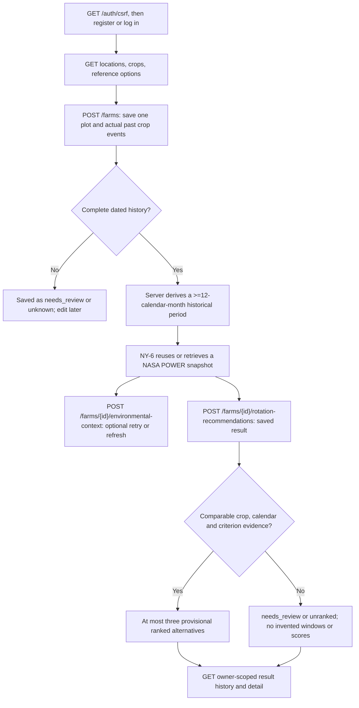

# Authenticated saved-farm API workflow (NY-39/NY-40)

This guide describes the current `/api/v1` farm-to-assessment flow. A farmer reports one plot's actual crop history once, through the owned Farm profile. The backend derives the historical NASA POWER period and saves the assessment. The farmer does not submit separate NASA dates, future planting dates, coordinates, an owner ID, or a current-practice baseline.



## Local data and account prerequisites

Configure MongoDB and private values from `backend/.env.example`. From `backend/`, populate the supported places and versioned crop, soil, irrigation, profile and calendar catalogs before creating farms:

```powershell
python -m app.farms.seed_locations
python -m app.farms.seed_catalogs
```

These commands add missing stable keys and can be rerun. The six candidate crop identities are maize, cowpea, groundnut, cassava, yam, and rice; some additional catalog crops are selectable only for past history. A catalog identity does not certify local suitability. For a database containing older free-text farms, run:

```powershell
python -m app.farms.migrate_legacy
```

That explicit migration marks old records `legacy_unresolved`. It does not infer crop identities, event dates, soil choices, or recommendations. The owner must review and update the farm through the current API.

NovaYield uses an HttpOnly database-backed session cookie. Call `GET /api/v1/auth/csrf` first; it returns `204 No Content` and sets a readable `nova_yield_csrf` cookie. Copy that cookie's value to `X-CSRF-Token` for `POST`, `PATCH`, and logout, and send cookies with requests. Registration and login both accept JSON `email` and `password`; login sets the HttpOnly `nova_yield_session` cookie. The [authentication guide](authentication.md) has the exact request sequence and Postman steps. Browser clients must use a consistent site for the API and frontend; credentialed CORS is restricted to configured origins.

## 1. Load selectable choices

| Method and route | Use |
| --- | --- |
| `GET /api/v1/farms/locations` | Supported `location_key`/label pairs and the limited-coverage notice. |
| `GET /api/v1/crops?usage=history` | Stable crop keys/IDs, names, history-selectable flag, candidate flag, and evidence status. |
| `GET /api/v1/crops?usage=recommendation` | The same catalog filtered to candidate crops. |
| `GET /api/v1/farms/reference-options` | Selectable soil texture and irrigation access keys, labels, and definitions, including `unknown`. |

The three initial place labels are Ejura, Anyinasu, and Kintampo. Their stored public place points are reference locations, not measured coordinates of a farmer's field. The API returns keys and labels, never the points.

## 2. Save one Farm v2 plot

`POST /api/v1/farms` creates an owned farm. This is a **synthetic request shape example**, not a real farm report or planting advice:

```json
{
  "name": "Example plot",
  "location_key": "ejura",
  "soil_texture_key": "unknown",
  "irrigation_access_key": "unknown",
  "history_status": "complete",
  "crop_history": [
    {
      "crop_key": "maize",
      "sequence_order": 1,
      "start_date": "2024-03-01",
      "end_date": "2024-06-15"
    }
  ],
  "declared_gaps": [],
  "current_plot_available": null,
  "earliest_available_date": null
}
```

The response (`201 Created`) contains an ID, revision, safe choice labels, ordered history, and `environmental_context` status/period/provenance. A complete history has one to three catalog-selected events in oldest-first `sequence_order`, with actual inclusive planting/establishment and harvest/removal dates. Past event dates cannot be in the future. An intercrop/overlap, an uncertain date, or an unexplained interval belongs in `needs_review`; `unknown` means no asserted events or gaps.

For two or three events, report each real interval between crops with `declared_gaps` entries using `start_date`, `end_date`, `status` (`fallow`, `idle_unknown_management`, or `unknown`) and `source: "farmer_reported"`. Complete history requires contiguous coverage of each between-crop interval by confirmed `fallow` or `idle_unknown_management` reports. An unknown interval stays `needs_review`; the server never assumes fallow or a soil benefit.

`current_plot_available` may be true, false, or null (unknown). A true value requires an explicit `earliest_available_date` that is no earlier than the last reported crop end. The date may be in the past if the plot is already free; it is an availability report, not a generated planting date. False may include a known future availability date; null makes no scheduling claim. Optional `farmer_priorities` carries four nonnegative points (`water_resilience`, `soil_health_potential`, `yield_stability_proxy`, `labor_feasibility`), at least one positive when supplied. The server normalizes them for the evidence available.

Use `GET /api/v1/farms` and `GET /api/v1/farms/{farm_id}` to read owned profiles; `PATCH /api/v1/farms/{farm_id}` accepts a partial update. Changing history or place may change the derived context period. All farm reads/writes use the authenticated owner ID as a query constraint. A missing or another user's farm returns the same `404`.

### Derived historical NASA period

For a complete history, the server keeps the farmer's original event dates and derives inclusive POWER bounds:

```text
history_start = earliest reported event start
history_end   = latest reported event end
context_start = earlier of history_start or (history_end minus 12 calendar months)
context_end   = history_end
```

For the synthetic event above, the period is **2023-06-15 through 2024-06-15**, with policy version `ny38-calendar-month-v1`. This is a historical observation range, never a weather forecast or a second farmer-entered season. Saving a complete Farm first makes the profile durable; the backend then tries to retrieve/reuse its NY-6 snapshot. NASA failure leaves the owned Farm retrievable with an honest `unavailable` or `partial` context state and a retry route. A draft has `needs_review` context until its reported history is completed.

## 3. Retrieve or refresh environmental context

Call `POST /api/v1/farms/{farm_id}/environmental-context` with **no body** or `{}`. To request an explicit refresh of the saved period, send:

```json
{ "force_refresh": true }
```

The route authorizes the Farm before resolving the private place point. It uses the saved derived period; `start_date`, `end_date`, coordinates, and owner IDs are forbidden request fields. NY-6 reuses an eligible persisted snapshot without another NASA call, or retrieves and saves the needed POWER `PRECTOTCORR`, `T2M`, and `T2M_MAX` daily values. NY-7 calculates the three plain-language precipitation/temperature indicators where valid coverage permits them. Missing values remain missing.

The response includes `period`, `context_status`, `snapshot_id`, `data_status` (`live`, `cached`, or `unavailable`), `cache_action`, `freshness_status`/explanation/age, `refresh_attempted`, safe `error_code`/warnings, and indicator units, source, coverage, resolution, and calculation version. A provider failure can return `200` with `data_status: "unavailable"` and no invented value; it is distinct from an authorization or validation error.

Freshness follows the POWER source and publication window, including configured recent-publication and GEOS-IT replacement/recheck rules. Old historical snapshots do not expire under a universal TTL. If a refresh fails, a valid prior snapshot remains available with its cached status, period, retrieval time, and warning. The relevant timings are configurable in `backend/.env.example` and the approved policy is in [Product Decision 8](../../novayield-research-and-product-decisions.md).

## 4. Generate and read a saved rotation assessment

Call `POST /api/v1/farms/{farm_id}/rotation-recommendations` with **no body** or `{}` to use the Farm's saved priorities. For one run, the only optional request field is:

```json
{
  "priority_adjustment": {
    "water_resilience": 25,
    "soil_health_potential": 25,
    "yield_stability_proxy": 25,
    "labor_feasibility": 25
  }
}
```

This does not edit the Farm's priorities. The route loads the owned Farm, its persisted NASA context and indicators, versioned candidate crop data, and the NY-8 scoring service, then saves the exact result through NY-20. It accepts no past history resubmission, future windows, `force_refresh`, plot reference, or current-practice text. The new workflow's `baseline_status` is `deferred` and `scoring_result.baseline_option` is null; historical v1 result records remain readable under their original schema.

The `201 Created` result is useful even when evidence is insufficient. Read `decision_status` first:

| Status | Meaning |
| --- | --- |
| `ranked_provisional` | Comparable evidence supports a provisional ranked shortlist of at most three options. |
| `needs_review` | Candidate timing or agronomic evidence needs review; an empty `scoring_result.options` is expected. |
| `unranked` | No defensible overall comparison passed the evidence gate. |
| `unavailable` | Required historical environmental context could not be used. |

`future_window_summary` reports candidate/scheduling counts and `review_reasons`, including when no options are returned. If `scoring_result.options` is empty, `unranked_calendar_examples` may contain up to three complete dated candidate sequences selected deterministically for calendar review. Each has `status: "unranked_needs_review"`, event windows, review reasons, and a selection note; none has a rank, suitability finding, benefit claim, or agronomic endorsement. The current seed leaves this array empty. If supported ranked options exist, their `scoring_result.options[].candidate.events[].event` contain sourced planting and harvest window bounds, `calendar_status`, and review reasons. These windows are provisional until local validation. `scoring_result` also contains criterion-level evidence, ranking mode, criteria used, normalized selected/equal weights, sensitivity, assumptions, and explicit strengths/concessions. Four comparable criteria are preferred; Decision 13's water-first, then comparable-soil fallback applies when the four are incomplete. Priorities change only the weights for criteria used in that mode. Missing water comparability withholds a rank.

The result records `history_event_snapshots`, `derived_context_period`, `context_provenance`, `climate_reference_provenance`, `indicators`, `climate_features`, `climate_feature_status_reason`, source/profile/calendar version IDs, and `candidate_pool_summary`. The narrow climate feature, when its evidence is complete, is a provisional 1991–2020 historical dry-spell exposure at a sourced sensitive crop stage. It is neither a future forecast nor a measured crop water balance. Missing calendar/stage/reference evidence leaves it `not_assessed`. The current seed intentionally lacks exact pilot planting, maturity and stage pairs and may therefore produce `needs_review` with no ranked options or dated future windows. Do not show an arbitrary unranked sequence as advice.

Retrieve saved history with `GET /api/v1/farms/{farm_id}/rotation-results` and a single record with `GET /api/v1/farms/{farm_id}/rotation-results/{result_id}`. Both routes constrain the farm, result, and authenticated owner. They return saved results without recomputing them or contacting NASA.

## Error and evidence boundaries

- `401` means the session is absent or expired; `403` means the CSRF check failed on a mutation.
- `404` does not distinguish a missing Farm/result from another user's ID. `409` means the saved Farm history is incomplete for context or generation, or changed while a request was in progress.
- `422` covers malformed payloads, unknown catalog keys, invalid dates, order, or gap reports. Dependency failures may return a safe `503`; NASA missing/partial data is also represented in a successful response with explicit status and warnings.
- The response never exposes session secrets or precise farm coordinates. Soil texture and irrigation choices are farmer reports, not measured field-water capacity or delivered water. Relative ratings and dry-spell exposure are not probabilities, yields, soil measurements, or guaranteed planting advice.

The approved boundaries and provisional assumptions are recorded in [Product Decisions §6](../../novayield-research-and-product-decisions.md) and the [NY-38 research handoff](../../analysis_docs/research/ny-38-research-handoff.md).
